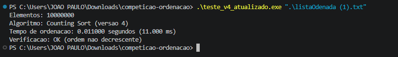

# Competição de Ordenação em C

## Integrantes

1. João Paulo Brustolom de Oliveira — Líder
2. Luiz Fernando Ropelatto de Oliveira
3. Samuel Victor Bueno Ribeiro
4. Alessandro Montessi da Silva

## Objetivo

Desenvolver um algoritmo de ordenação em linguagem C capaz de ordenar 10 milhões de números inteiros no menor tempo possível.

## Algoritmo utilizado

Utilizamos o Counting Sort otimizado (Versão 4).

O Counting Sort funciona contando quantas vezes cada número aparece e, depois, reconstruindo o vetor em ordem crescente.

Sua complexidade de tempo é O(N + K), em que:

- N representa a quantidade de elementos.
- K representa a amplitude dos valores.

A versão 4 utiliza processamento em blocos durante a contagem para melhorar o desempenho.

## Arquivos

- `ordenacao_v3.c` — código-base necessário para compilar a V4.
- `ordenacao_v4.c` — versão otimizada do algoritmo.
- `resultado.jpeg` — comprovante da execução.

## Compilação

É necessário ter o compilador GCC instalado.

No terminal, execute:

```bash
gcc -O3 -march=native -flto -std=c11 -Wall -Wextra ordenacao_v4.c -o ordenacao_v4.exe
```

## Execução

Coloque o arquivo de dados na pasta do projeto.

No PowerShell do Windows, execute:

```powershell
.\ordenacao_v4.exe ".\listaOdenada (1).txt"
```

## Resultados obtidos

O algoritmo foi testado com 10.000.000 de elementos.

- Algoritmo: Counting Sort (Versão 4)
- Melhor tempo: 10 ms
- Mediana de 10 testes: 11 ms
- Verificação: OK

A medição utiliza a função `clock()`, considerando apenas o tempo da ordenação, sem incluir a leitura do arquivo.

## Verificação

Após a execução, o programa verifica se os elementos estão em ordem não decrescente.

O algoritmo preserva os elementos repetidos e não elimina valores durante a ordenação.

## Comprovação da execução


